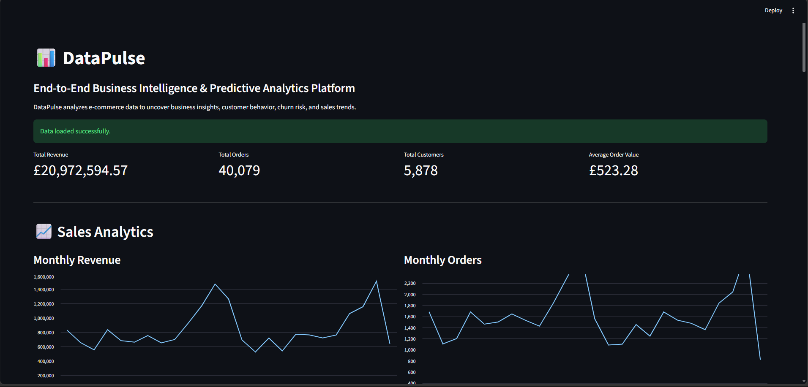
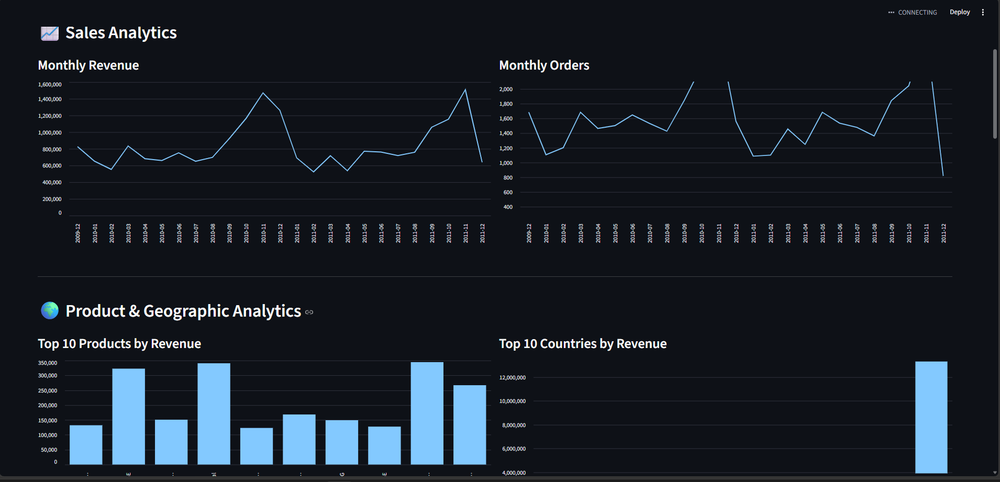
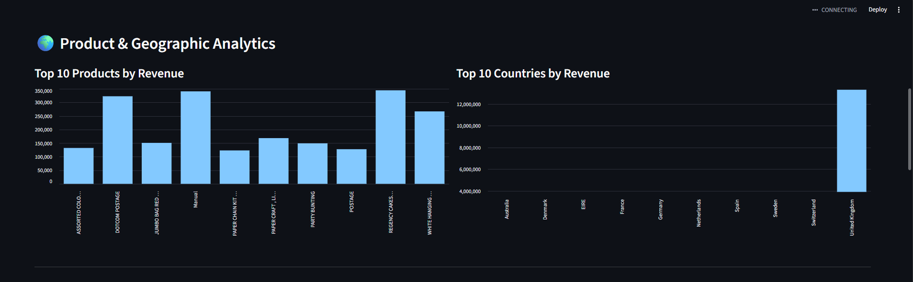
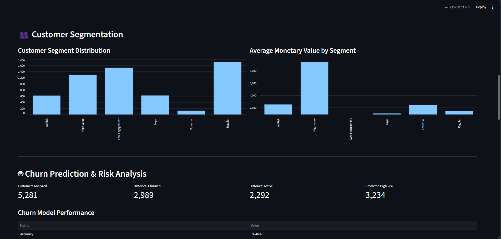
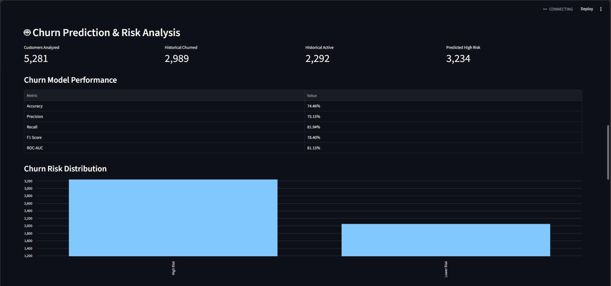
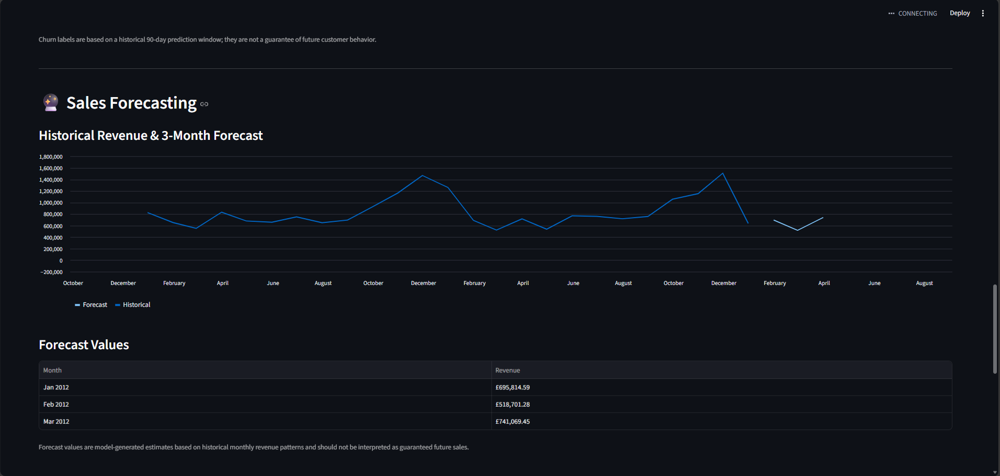
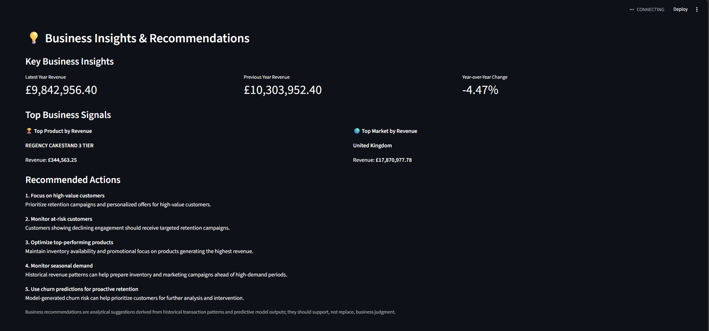

# 📊 DataPulse

## End-to-End Business Intelligence & Predictive Analytics Platform

[](https://www.python.org/)
[](https://streamlit.io/)
[](https://scikit-learn.org/)
[](https://pandas.pydata.org/)
[](https://plotly.com/)
[](#testing)
[](#project-status)

### 🚀 Live Demo

[](https://datapulse-business-analytics.streamlit.app)

**Live Application:**  
https://datapulse-business-analytics.streamlit.app

**Repository:**  
https://github.com/mdsakibhasan-cs/DataPulse

---

## 📌 Overview

**DataPulse** is an end-to-end Business Intelligence and Predictive Analytics platform built with Python and Streamlit.

The platform transforms raw e-commerce transaction data into actionable business intelligence through:

- Data cleaning and validation
- Exploratory data analysis
- Business KPI analytics
- Customer behavior analysis
- RFM customer segmentation
- Customer churn prediction
- Sales forecasting
- Business insights and recommendations
- Interactive data visualization

The project combines **Data Science, Machine Learning, Business Analytics, and Software Engineering** into a single portfolio-ready analytical platform.

---

## 🎯 Project Objectives

DataPulse was designed to demonstrate the complete analytical workflow from raw transactional data to predictive business decision support.

### Primary objectives

- Understand large-scale e-commerce transaction data
- Build a reproducible data-cleaning pipeline
- Analyze revenue, orders, products, customers, and geography
- Identify customer segments using RFM analysis
- Predict historical customer churn risk using machine learning
- Forecast short-term monthly revenue
- Convert analytical results into business recommendations
- Deliver all results through an interactive Streamlit dashboard

---

## 🧠 End-to-End Pipeline

```text
Raw E-Commerce Data
        │
        ▼
Data Loading
        │
        ▼
Data Cleaning & Validation
        │
        ▼
Exploratory Data Analysis
        │
        ├──────────────► Business KPI Analytics
        │
        ├──────────────► Product & Country Analysis
        │
        ├──────────────► RFM Customer Analysis
        │                         │
        │                         ▼
        │                 Customer Segmentation
        │
        ├──────────────► Churn Feature Engineering
        │                         │
        │                         ▼
        │                 Churn Prediction
        │
        └──────────────► Monthly Revenue Modeling
                                  │
                                  ▼
                           Sales Forecasting
                                  │
                                  ▼
                     Business Insights & Recommendations
                                  │
                                  ▼
                     Interactive Streamlit Dashboard
```

---

# 📊 Dashboard Preview

## 1. Executive Overview



The overview provides the main business KPIs and high-level revenue analytics in a single dashboard.

---

## 2. Revenue Analytics



Monthly revenue and order trends provide a time-based view of business performance and seasonality.

---

## 3. Product & Country Analysis



The dashboard identifies the highest-revenue products and leading countries by sales contribution.

---

## 4. Customer Segmentation



RFM-based segmentation categorizes customers according to recency, purchasing frequency, and monetary value.

---

## 5. Churn Prediction



The churn analysis section presents the historical prediction setup, model performance, and customer risk distribution.

---

## 6. Sales Forecasting



The forecasting module combines historical monthly revenue with model-generated three-month revenue estimates.

---

## 7. Business Insights



The final dashboard section translates analytical and predictive outputs into practical business recommendations.

---

# ✨ Key Features

## 1. Data Cleaning

The raw Online Retail II dataset contains cancelled transactions, invalid quantities, invalid prices, and missing customer identifiers.

DataPulse applies the following transaction-level cleaning rules:

- Keeps transactions with `Quantity > 0`
- Keeps transactions with `Price > 0`
- Excludes invoices beginning with `C`
- Calculates transaction revenue as:

```text
TotalAmount = Quantity × Price
```

Missing customer IDs are retained for general sales analytics but excluded from customer-level analyses that require a known customer identity.

---

## 2. Business Intelligence & KPI Analytics

DataPulse calculates key business metrics including:

- Total revenue
- Total quantity sold
- Total orders
- Unique products
- Unique customers
- Unique countries
- Average order value
- Monthly revenue
- Monthly order volume
- Yearly revenue
- Top products
- Top countries
- Customer revenue contribution

### Verified Dataset-Level Results

| Metric | Result |
|---|---:|
| Clean transactions | 1,041,670 |
| Unique orders | 40,079 |
| Unique products | 4,917 |
| Unique customers | 5,878 |
| Countries | 43 |
| Total quantity | 11,420,305 |
| Total revenue | £20,972,594.57 |
| Average order value | £523.28 |

---

# 👥 Customer Segmentation

DataPulse uses **RFM analysis** to understand customer behavior.

### RFM Components

- **Recency** — how recently a customer purchased
- **Frequency** — how often a customer purchased
- **Monetary** — how much revenue a customer generated

Customers are assigned RFM scores and categorized into business-oriented segments.

### Customer Segments

- High Value
- Loyal
- Potential
- At Risk
- Low Engagement
- Regular

### Verified Segment Distribution

| Segment | Customers |
|---|---:|
| Regular | 1,701 |
| Low Engagement | 1,526 |
| High Value | 1,292 |
| Loyal | 618 |
| At Risk | 616 |
| Potential | 125 |
| **Total** | **5,878** |

---

# 🤖 Customer Churn Prediction

DataPulse includes a leakage-aware historical churn prediction pipeline.

Instead of defining churn directly from the same transaction period used for model features, the project uses a **historical cutoff methodology**:

```text
Historical Transactions
        │
        ▼
90-Day Cutoff
        │
        ├──► Historical Features
        │       ├── Recency
        │       ├── Frequency
        │       ├── Monetary
        │       ├── Average Order Value
        │       ├── Total Quantity
        │       ├── Unique Products
        │       └── Tenure
        │
        ▼
Future 90-Day Window
        │
        ▼
Churn Label
```

A customer is labeled as churned when they have no transaction during the future 90-day observation window.

### Models Evaluated

- Logistic Regression
- Random Forest
- Gradient Boosting

### Final Model

**Gradient Boosting Classifier**

### Verified Performance

| Metric | Score |
|---|---:|
| Accuracy | 74.46% |
| Precision | 75.15% |
| Recall | 81.94% |
| F1 Score | 78.40% |
| ROC-AUC | 81.15% |

### Historical Churn Dataset

| Metric | Result |
|---|---:|
| Customers analyzed | 5,281 |
| Historical churned | 2,989 |
| Historical active | 2,292 |
| Historical churn rate | 56.6% |

> **Important:** These results are dataset-specific evaluation results from the historical prediction setup. They should not be interpreted as a guarantee of future customer behavior.

---

# 📈 Sales Forecasting

DataPulse forecasts short-term monthly revenue using a lag-based machine learning approach.

### Forecast Features

- Previous month revenue
- Two-month lag
- Three-month lag
- Month number
- Year

### Model

**Gradient Boosting Regressor**

### Forecast Horizon

**3 months**

### Verified Forecast

| Month | Forecast Revenue |
|---|---:|
| January 2012 | £695,814.59 |
| February 2012 | £518,701.28 |
| March 2012 | £741,069.45 |

> **Important:** Forecast values are model-generated estimates based on historical transaction patterns. They are not guaranteed future sales values.

---

# 💡 Business Insights

DataPulse converts analytical outputs into practical business recommendations.

### Example recommendations generated by the platform

1. **Focus on high-value customers**  
   Prioritize retention and engagement strategies for customers with strong monetary and purchasing behavior.

2. **Monitor at-risk customers**  
   Use historical churn-risk predictions to identify customers who may require proactive retention efforts.

3. **Optimize top-performing products**  
   Analyze high-revenue products to support inventory and product strategy decisions.

4. **Monitor seasonal demand**  
   Use monthly revenue patterns to identify periods of increased or decreased demand.

5. **Use churn predictions for proactive retention**  
   Combine customer segmentation with churn-risk information to support targeted customer engagement.

> These recommendations are analytical decision-support outputs and should complement, not replace, business judgment.

---

# 🏗️ Project Architecture

```text
DataPulse/
│
├── app/
│   └── app.py
│
├── src/
│   ├── data_loader.py
│   ├── eda.py
│   ├── business_insights.py
│   ├── customer_segmentation.py
│   ├── churn_model.py
│   └── forecasting.py
│
├── models/
│   └── churn_gradient_boosting.joblib
│
├── reports/
│   └── churn_model_evaluation.csv
│
├── screenshots/
│   ├── 01-overview.png
│   ├── 02-revenue-analytics.png
│   ├── 03-product-country-analysis.png
│   ├── 04-customer-segmentation.png
│   ├── 05-churn-prediction.png
│   ├── 06-sales-forecasting.png
│   └── 07-business-insights.png
│
├── tests/
│   └── test_datapulse.py
│
├── requirements.txt
├── .gitignore
└── README.md
```

---

# 🔧 Technical Architecture

DataPulse separates data processing, analytical logic, machine learning, and presentation layers.

### Data Layer

Responsible for:

- Loading the UCI Online Retail II dataset
- Combining yearly sheets
- Cleaning transactions
- Creating transaction-level revenue
- Preparing reusable clean data

### Analytics Layer

Responsible for:

- Exploratory data analysis
- KPI calculation
- Revenue trends
- Product analysis
- Country analysis
- Customer revenue analysis

### Customer Analytics Layer

Responsible for:

- RFM calculation
- Customer scoring
- Customer segmentation

### Machine Learning Layer

Responsible for:

- Churn dataset construction
- Feature engineering
- Model training
- Model evaluation
- Model persistence
- Revenue forecasting

### Presentation Layer

Streamlit provides:

- Interactive KPI cards
- Charts
- Tables
- Customer segmentation views
- Churn risk analysis
- Forecasting results
- Business recommendations

---

# 🛠️ Technology Stack

| Technology | Purpose |
|---|---|
| Python | Core development |
| Pandas | Data manipulation and analytics |
| NumPy | Numerical computing |
| scikit-learn | Machine learning |
| Streamlit | Interactive dashboard |
| Plotly | Interactive visualization |
| Matplotlib | Data visualization support |
| Seaborn | Statistical visualization support |
| Joblib | Model serialization |
| OpenPyXL | Excel data processing |
| Pytest | Automated testing |
| Git & GitHub | Version control and portfolio management |

---

# 📦 Dataset

### UCI Online Retail II

DataPulse uses the **Online Retail II** dataset from the UCI Machine Learning Repository.

The dataset contains transaction-level e-commerce records including:

- Invoice number
- Product code
- Product description
- Quantity
- Invoice date
- Unit price
- Customer ID
- Country

### Raw Dataset

- 1,067,371 raw transaction rows
- Two yearly sheets
- 2009–2010
- 2010–2011

### Processed Dataset

After transaction-level cleaning:

**1,041,670 valid transactions**

The raw dataset is intentionally **not stored in the Git repository**. For deployment, DataPulse downloads the dataset from the UCI source when it is not already available locally.

---

# ▶️ Local Installation

## 1. Clone the repository

```bash
git clone https://github.com/mdsakibhasan-cs/DataPulse.git
cd DataPulse
```

## 2. Create a virtual environment

### Windows

```powershell
python -m venv .venv
.venv\Scripts\activate
```

### macOS / Linux

```bash
python3 -m venv .venv
source .venv/bin/activate
```

## 3. Install dependencies

```bash
pip install -r requirements.txt
```

## 4. Run the Streamlit application

```bash
streamlit run app/app.py
```

The application will open in your browser.

---

# 🧪 Testing

DataPulse includes automated tests covering core data-cleaning and customer-segmentation functionality.

Run:

```bash
pytest
```

### Verified Test Result

```text
3 passed
```

The tests cover:

- Invalid transaction removal
- RFM calculation
- Customer segmentation output

---

# ☁️ Deployment

DataPulse is deployed using **Streamlit Community Cloud**.

### Production Application

https://datapulse-business-analytics.streamlit.app

The application uses the GitHub repository as its source and automatically reflects committed application updates.

### Deployment Entry Point

```text
app/app.py
```

### Dependency Management

Python dependencies are pinned in:

```text
requirements.txt
```

The dataset is downloaded automatically when required, allowing the application to run without committing the large raw Excel dataset to GitHub.

---

# 🔒 Data & Security Considerations

DataPulse is designed as an analytical portfolio project and does not require user authentication or sensitive credentials.

Important design considerations:

- No API keys are required
- Raw dataset files are excluded from Git version control
- Analytical models operate on historical transaction data
- Churn predictions are presented as decision-support outputs
- Forecasts are explicitly treated as estimates rather than guaranteed outcomes

---

# ⚠️ Limitations

DataPulse is a portfolio and educational analytics platform rather than a production enterprise BI system.

### Current limitations

- The dataset represents historical e-commerce transactions.
- Customer churn labels depend on the selected historical observation window.
- Churn predictions are dataset-specific and may not generalize to other businesses.
- Revenue forecasting uses a relatively small monthly time series.
- Forecasts are model estimates and do not account for external factors such as promotions, economic conditions, supply constraints, or market shocks.
- RFM segments are rule-based and may require business-specific calibration.
- Missing customer identifiers prevent some transactions from being used in customer-level analysis.

These limitations are intentionally documented to keep model interpretation realistic.

---

# 📊 Key Learning Outcomes

This project demonstrates practical experience with:

### Data Science

- Data cleaning
- Exploratory data analysis
- Feature engineering
- Statistical summaries
- Customer analytics

### Machine Learning

- Classification
- Regression
- Model comparison
- Model evaluation
- ROC-AUC
- Precision / Recall / F1
- Historical leakage-aware dataset construction

### Business Analytics

- KPI design
- Revenue analysis
- Customer segmentation
- Churn-risk analysis
- Forecasting
- Business recommendations

### Software Engineering

- Modular Python architecture
- Reusable analytical functions
- Model serialization
- Automated testing
- Dependency management
- Git version control
- Streamlit deployment

---

# 📁 Project Outputs

DataPulse produces reusable analytical and machine-learning outputs including:

- Clean transaction dataset
- Business KPI summaries
- Monthly revenue analysis
- Product performance analysis
- Country performance analysis
- RFM customer dataset
- Customer segment assignments
- Churn model
- Churn evaluation report
- Revenue forecast
- Interactive dashboard
- Business recommendations

---

# 🚀 Project Status

**Completed and deployed.**

The current version includes the complete planned analytics pipeline:

```text
Data Cleaning
      ↓
EDA
      ↓
Business Analytics
      ↓
RFM Segmentation
      ↓
Churn Prediction
      ↓
Sales Forecasting
      ↓
Business Insights
      ↓
Streamlit Dashboard
      ↓
Cloud Deployment
```

---

# 👨‍💻 Author

## MD Sakib Hasan

Computer Science & Technology  
Nantong University

### Interests

- Data Science
- Machine Learning
- Cybersecurity
- Artificial Intelligence
- Software Engineering
- Data Analytics

### Portfolio

**GitHub:**  
https://github.com/mdsakibhasan-cs

**DataPulse Repository:**  
https://github.com/mdsakibhasan-cs/DataPulse

**Live DataPulse Application:**  
https://datapulse-business-analytics.streamlit.app

---

# ⭐ Project Summary

**DataPulse** demonstrates an end-to-end approach to transforming raw e-commerce transactions into business intelligence and predictive analytics.

The project combines:

**Data Engineering → Data Analysis → Customer Analytics → Machine Learning → Forecasting → Visualization → Business Decision Support**

with a modular Python architecture and an interactive Streamlit deployment.

---

## 📌 Final Links

| Resource | Link |
|---|---|
| 🚀 Live Application | https://datapulse-business-analytics.streamlit.app |
| 💻 GitHub Repository | https://github.com/mdsakibhasan-cs/DataPulse |

---

### 📄 License

This project is licensed under the [MIT License](LICENSE).